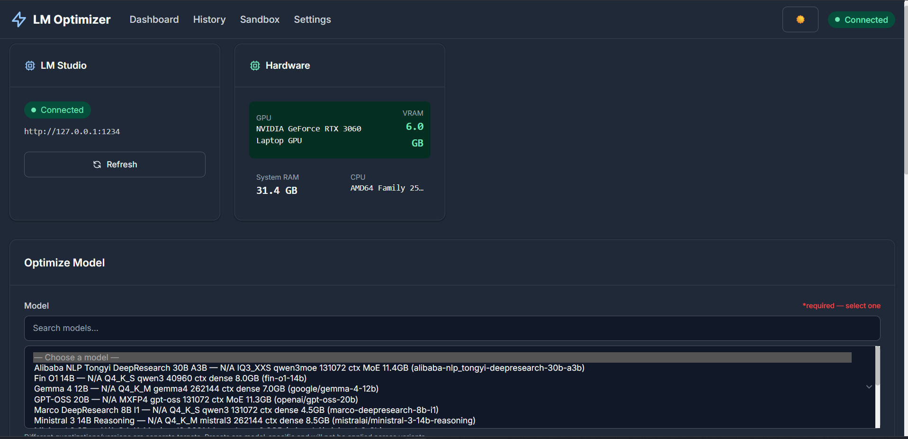
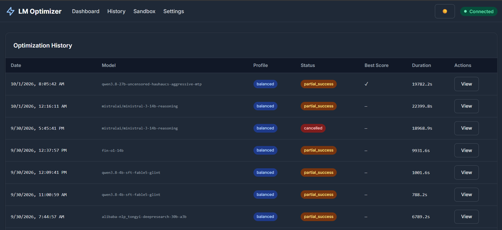
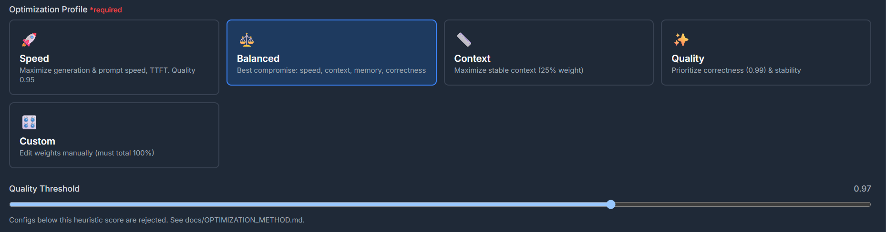
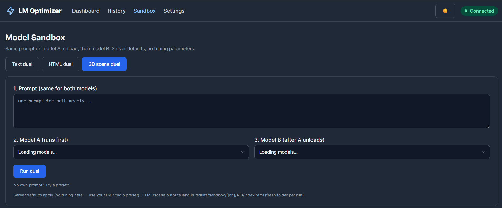
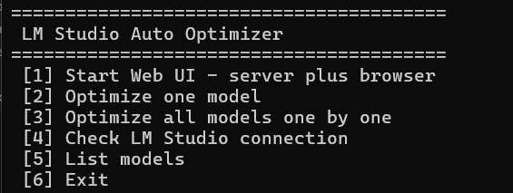

# LM Studio Auto Optimizer

Hardware-aware automatic benchmarking and runtime configuration optimization for LM Studio.
Finds empirically validated inference configurations for your hardware, model and goal —
not theoretical optima. Includes a model-vs-model sandbox (text / HTML / 3D-scene duels),
transparent results with per-test outputs, and a dark-mode web UI.

**Status: v1.5.2.** Pause/resume for partial successes (Web UI + CLI), AI-assisted model selection,
speed-first search (cheap probes → quality validation on finalists → bounded causal recovery → adaptive validation),
sandbox duels with history, Prompt/Thinking/Output transparency, OS-following dark mode, resilient Web UI.
719 automated tests green (mock-only; live-server E2E validated on earlier suites).

| Platform | Status |
|-|-|
| Windows | ✅ Verified (RTX 3060 6 GB host) |
| Linux | ⬜ Scripts ready (`run-web.sh`), not yet live-verified |
| macOS | ⬜ CI-tested (install + suite on macOS runner); Apple Silicon reports unified memory honestly (no fake VRAM); live run untested — testers welcome |

## Screenshots

| Dashboard | History |
|-|-|
|  |  |

| Optimization Profiles | Sandbox |
|-|-|
|  |  |

| CMD menu (no UI) |
|-|
|  |

## Example report (success `.md`)

Every validated run writes `results/<model>-best.md` (excerpt, host details omitted):

```markdown
# Best settings: qwen3.8-9b-distill
* Profile: balanced (style: balanced) | Elapsed: 1004.4s

## Best load configuration (REST-settable)
|Parameter|Value|Verdict|
|context_length|8192|tested (8192)|
|flash_attention|yes|verified best of tested (False, True)|
|offload_kv_cache_to_gpu (KV on GPU)|yes|verified best of tested (False, True)|
|eval_batch_size|128|verified best of tested (128, 1024, 2048)|

## Requested vs applied (winner load verification)
* Load channel: REST | Verification: MATCH

## Winner: every test explicitly
|Test|Gen tok/s|Quality|Status|
|short_instruction|22.8|1.0 (6/6)|PASS|
|medium_reasoning|32.2|1.0 (6/6)|PASS|
|long_context|30.4|1.0 (6/6)|PASS|
|coding_task|26.9|1.0 (6/6)|PASS|
|structured_output|34.2|1.0 (6/6)|PASS|
```

## Measured results (RTX 3060 6 GB, Phase-A campaign, Phase B OFF)

Validated winners (fastest quality-passing config):

|Model|Best|Speed|Quality|
|-|-|-|-|
|ministral-3-3b|ctx 32768, flash on, KV-GPU, batch 128|74.9 tok/s|1.000 (30/30)|
|qwen3.8-9b-distill|ctx 32768, flash on, KV-GPU, batch 2048|28.2 tok/s|0.983 (29/30)|
|gemma-4-12b|ctx 32768, flash on, KV-GPU, batch 2048|7.1 tok/s|0.987 (29/30)|
|gpt-oss-20b|ctx 32768, flash on, KV-GPU, batch 1024|12.1 tok/s|1.000 (30/30)|

Honest no-winners (measured, none passed quality — not config bugs): qwen3.8-4b
(structured-JSON fails), marco-8b (0.65–0.73), ministral-14b (0.60–0.68),
alibaba-30b (incl. MoE rollback). Unloadable: ternary-27b. Details in
`results/campaign/` (`INDEX.md`, `CAMPAIGN_SUMMARY.md`).

## Launchers per OS (same tree and files, only the starter differs)

**Windows** (`.bat`):

```bat
start_optimizer.bat          REM primary Windows launcher (menu: Web UI, checks, models, benchmark, optimize)
run-all.bat                  REM utility: everything overnight (tests + tuning + ceilings)
run-model.bat <key> [ctx]    REM utility: one model
run-model.bat ALL [ctx]      REM utility: all models one by one (small first)
run-web.bat                  REM utility: web UI on http://127.0.0.1:8080
```

**Linux** (`.sh`, macOS uses the same scripts — untested):

```bash
chmod +x run-web.sh run-optimizer.sh
./run-web.sh                 # web UI on http://127.0.0.1:8080
./run-optimizer.sh status    # CLI passthrough, e.g. ./run-optimizer.sh models
./run-optimizer.sh auto      # all models one by one (small first); --skip a,b to skip
```

> macOS: same `.sh` launchers are expected to work (Metal detection is coded,
> `lms` CLI optional) but no Mac has run them yet — report back if you try.

Prerequisites (both): LM Studio running with Developer server on `127.0.0.1:1234`,
KV cache quantization **Q4 starter** + CPU threads at logical maximum (both GUI-only,
REST cannot set them — verified). **Keep Model in Memory must be OFF** during runs —
otherwise unloads do not take effect and the run stops fail-closed (see Troubleshooting §11).
See `python -m lm_optimizer recommend --vram 6`.

Manual install:

```bash
pip install -e ".[dev]"
cp .env.example .env    # Windows: copy .env.example .env
python -m pytest -q
```

## CLI reference

|Command|What it does|Live load?|
|-|-|-|
|`status`|connection + probed capabilities + hardware|probe only|
|`models`|list local models (size, quant, ctx, MoE)|probe only|
|`inspect <model>`|model detail + supported params|probe only|
|`recommend --vram 6 [--estimate]`|fit table + GUI/host checklist (+ `lms` estimates)|no|
|`benchmark <model> --context N --style S`|5-test suite, one config|yes|
|`optimize <model> [--dry-run] [--profile P] [--resume ID]`|Phase-A tuning + preset + report|yes|
|`compare <model> --config-a A --config-b B [--tests T]`|A/B configs on the same tests|yes|
|`auto [models] [--skip X,Y]`|smoke → precision → ladder → matrix → optimize|yes|
|`fit [models]`|max-context ladder per KV path|yes|
|`ctx <model> [--quality-rungs N]`|geometric context sweep + bisect (+ full quality suites)|yes|
|`pause <id>` / `resume <id> [--skip-phases]` / `run-status`|graceful pause + resume under same ID|no|
|`checkpoints`|list interrupt checkpoints|no|
|`param-matrix [--record]`|parameter control matrix (+ DB snapshot)|no|
|`apply / restore / presets / runs`|presets and history management|apply/restore yes|
|`cleanup_test_runs`|remove test runs|no|
|`python hw_monitor.py [--model M]`|VRAM/RAM/swap snapshot; optional tok/s probe|only with `--model`|
|`python vram_matrix.py <model>`|12-config ctx×flash×KV fit/speed matrix|yes|
|`resume-menu [--status] [--limit]`|interactive menu to resume paused/incomplete runs|no|
|`judge <run_id> [--priority] [--vram-limit]`|AI-assisted model selection (second opinion)|no|
|`lab context-explorer <model>`|1.5x context ladder + fill ratios + needle retrieval|yes|
|`lab quality-lab <model> [--category C] [--seeds N]`|deterministic quality tasks, hard gates, reliability|yes|
|`lab recommend [--min-tps N] [--min-context N] [--vram-only]`|model recommendations from the local fingerprint + local measurements|no|
|`lab duel <model-a> <model-b> [--type T] [--mode M]`|controlled/best-profile duel, blind A/B judging|yes|

Benchmark styles: `precise` (code/math temp 0.1), `balanced` (suite defaults),
`creative` (summarization temp 0.9). Every command first unloads stale models and
verifies empty state; every load/unload is server-state verified.

## Web UI

```bash
python -m lm_optimizer.web_main   # http://127.0.0.1:8080
```

Pages: **Dashboard** (optimize form, live status, plain model dropdown, custom
priorities 0.00-1.00 + hard speed target), **History** (runs + sandbox duels,
config counts, stale flags, per-row checkboxes with bulk delete / re-run /
compare, abandon), **Results** (winner card, alternatives, charts, per-test
Prompt/Thinking/Output, full JSON page, Apply Best Config and Save LM Studio
config), **Sandbox** (text/HTML/3D duels with presets), **Brewery** (Lab +
Experiment Builder under one entry), **Settings**. API under single `/api` prefix
+ websocket progress. Dark mode follows the OS (toggle in nav). Read endpoints
are load-free and degrade gracefully when LM Studio is down.

**Pause/Resume (v1.5.2):** Running and paused runs show **Pause** / **Resume** buttons
on the Results page. History page has **Resume All Pending** to bulk-resume paused runs.
API: `POST /api/runs/{run_id}/pause` and `POST /api/runs/{run_id}/resume`.
Resume from checkpoint skips already-completed candidates (no re-runs).

## CLI Pause/Resume Menu (v1.5.2)

```bash
lm-optimizer resume-menu                    # interactive selection
lm-optimizer resume-menu --status paused    # filter by status
lm-optimizer checkpoints                    # list all checkpoints
lm-optimizer resume <run-id>                # direct resume (existing)
```

The `resume-menu` shows runs in `running`, `paused`, `resumed`, `partial_success` states
with progress info (completed configs, stage, VRAM). Select by number to resume.

## AI Model Judge (v1.5.2) — Second Opinion

```bash
lm-optimizer judge <run_id> --priority balanced --vram-limit 6
lm-optimizer judge <run_id> --priority speed --use-case coding
lm-optimizer judge <run_id> --backend heuristic  # default, no AI needed
```

**User decides first.** The judge provides analysis to help you choose:
- Heuristic backend (default): rule-based, fast, no external dependencies
- Local backend: uses a local model via LM Studio/Ollama (planned)
- API backend: uses external API like OpenRouter (planned)

Outputs: recommended config, reasoning, confidence, pros/cons, alternatives, VRAM warnings.

## Phase Skips, Fast Tests & Full Reports (v1.6.0)

**Skip phases** (CLI, API i GUI Dashboard): `speed,quality,recovery,validation,context`.

```bash
lm-optimizer optimize <model> --skip-phases recovery,validation
lm-optimizer auto --skip-phases context --skip a,b
lm-optimizer resume <run-id> --skip-phases quality   # finish the rest faster
lm-optimizer resume-menu --all                       # finish every pending run
```

Skips are stored on the run, so `resume` keeps them. Skipping `quality`
means no winner path (run ends without best config); skipping `context`
forces Phase B off. GUI: Dashboard → Advanced → Skip phases checkboxes
(same names); History → Resume All Pending finishes `paused`,
`partial_success` and `interrupted` runs.

**Faster tests.** `--warmup-runs 0-5` (default 1) on `optimize` / `auto` /
`ctx` — `0` skips the warmup suite pass per config (~15–20% faster quality
suites, slightly noisier first measurements). GUI: Advanced → Warmup runs.

**Full context + quality.** `ctx <model> --quality-rungs N
--quality-threshold 0.97` runs full quality suites on the top-N stable
ladder rungs (ctx, tok/s, quality, checks, VRAM, TTFT, PASS/FAIL table).

**Richer best reports.** Tested-configs table now shows run order `#`,
prompt tok/s, TTFT, VRAM per row; `--report-sort run|speed|quality`
(`optimize` / `auto`) reorders it. Report layout: Results first, then
best config, HW details, test details, tried configs, methodology last.

**Wider grid.** `--physical-batches 256,512,1024` adds a real search
dimension (`optimize` / `auto`). RoPE stays opt-in (`--enable-rope`);
temperatures are covered by `--style` (precise/balanced/creative),
`sample-sweep` and the auto precision probe.

**Reliability hardening (unreleased).** `optimize` / `auto` show one
pre-flight summary (model, profile, phases, experiments) and ask once
(`--yes` / `--non-interactive` never prompt; `--enable-rope False` as a
positional is rejected with exit 2). Experimental runs record
requested/resolved/applied/exercised detail in the report. Quality-skipped
exploration writes `<model>-explore.md` (`quality_validated: false`) and
never overwrites the validated preset or `-best.md`. `resume-menu` shows
checkpoint presence, phase/cursor, last progress and a safe-to-resume hint.
Failed-run reports group errors by normalized signature with per-signature
durations and a repeat-failure circuit-breaker verdict (flash-specific
failures never trip it).

**Granular test modes (v1.6.x).** One-purpose runs for quick answers, all
following the same `*-only` pattern (`--mtp-test` / `--reasoning-sweep`
remain accepted aliases of `--mtp-only` / `--reasoning-only`):

```bash
lm-optimizer optimize <model> --speed-only --context 16384  # only speed probes, context pinned
lm-optimizer optimize <model> --quality-only                # quality battery on the default config
lm-optimizer optimize <model> --mtp-only --context 16384    # only the speculative/MTP probes
lm-optimizer optimize <model> --reasoning-only --max-context 16384  # reasoning off/low/medium/high/xhigh
```

Modes compose onto the phase-skip machinery (each `*-only` derives its
required `--skip-phases` set automatically), so `resume` keeps the mode, the
pre-flight summary shows the real plan and no winner is fabricated without
the quality phase. `--context` is required with `--speed-only` / `--mtp-only`
(it pins the probe context, clamped to the model's advertised limit);
`--max-context` controls the quality context for `--quality-only` /
`--reasoning-only`, which measure the default (baseline) runtime. Mutually
exclusive with each other by design. Batch runner for whole model families:
`python tools/granular_suite.py` (sequential, job-lock aware, per-step
timeout plus a stall watchdog that kills a step producing no log output for
20 minutes, then reconciles the dead run).

**Operational tools.** `tools/verify_runs.py` checks persisted runs against
the acceptance invariants (resolved settings, speed-floor block, probe cap,
stage skips, explicit no-winner reason); `tools/webui_audit.py` renders every
page and key API endpoint over HTTP; `tools/speed_summary.py` reports median
and max generation speed per model; `tools/model_status.py` shows the latest
run per model. `lm-optimizer lab export-config <run-id>` writes the validated
winner as a reusable load-config JSON (REST params + vLLM engine config +
llama.cpp instructions).

**Cleanup (v1.6.x).** `cleanup.bat` one-click maintenance:
archives the run history first (whole `optimizer.db` snapshot plus
`data/reports` and `data/checkpoints` moved into `data/archive/cleanup_<ts>/`),
then deletes all run/benchmark rows from the DB, `data/logs` contents and
Python/test caches (`__pycache__`, `.pytest_cache`, `.ruff_cache`,
`.mypy_cache`). It keeps LM Studio models, `data/presets`, the curated
`results/` reports, the tuned presets and settings in the DB, and the archive
files themselves; refuses to run while the job lock is held. Variants:
`python tools/cleanup.py --dry-run` (inspect), `--logs-only` (no DB changes,
also as `cleanup-logs-only.bat`). LM Studio models and everything outside
the repo are never touched.

**Lab workflows (v1.6.x).** `lm-optimizer lab` groups the four workflows
that are NOT the runtime optimizer:

- `lab context-explorer <model>` - real context capacity: 1.5x geometric
  ladder (never power-of-two), binary refinement to 512 tokens, fill ratios
  (fast 0/50/90 %, detailed 0/25/50/75/90/98 %) and needle retrieval at
  5/25/50/75/95 %. A context that merely ALLOCATES is not reported as
  usable. Decode speed below 1 tok/s is `FAIL_TOO_SLOW`, kept distinct from
  OOM, with a 0.95-1.05 hysteresis band that gets re-measured.
- `lab quality-lab <model>` - deterministic quality tasks (instruction,
  coding, reasoning, structured JSON, Slovak, hallucination resistance)
  with hard gates (empty output, exit code, required files, unit tests,
  schema, exact functionality) evaluated BEFORE scoring - a broken output
  can never win on appearance. Reliability is reported as mean / median /
  worst / stdev / success rate over several seeds.
- `lab recommend` - model recommendations for the detected fingerprint. Fit
  is decided by FILE SIZE and bits/weight, never by parameter count
  (Bonsai 27B Q1_0 fits a 6 GB card, Q4 27B does not), MoE models are
  estimated from their ACTIVE parameters, and local measurements in the
  database outrank community priors.
- `lab duel <model-a> <model-b>` - controlled (identical context, sampling,
  seed) or best-profile duel with blind A/B judging; the judge never sees
  the model identity and may not be one of the candidates.

**Verified LM Studio capability boundaries (probed 2026-10-21).** This
build accepts the whole `speculative_draft_*` family over REST
(`speculative_draft_mtp`, `_simple`, `_model`, `_min_tokens`,
`_min_continue_probability`, `_max_tokens`). KV cache quantization
(`llama_k_cache_quantization_type` and every other spelling), CPU threads
(`cpu_threads` / `threads` / `num_threads` / `n_threads`) and mmap
(`try_mmap` / `keep_model_in_memory`) are **not** settable through REST
here (400 `unrecognized_keys`) - they are runtime facts set in the GUI, so
the optimizer records them instead of searching them. Draft-token counters
are parsed from the chat stats when the server exposes them; when it does
not, the MTP fields stay neutral (never fabricated).

## How it works (Phase-A strategy)

```
PREPARE → SPEED (fixed small ctx) → FRONTIER → QUALITY (frozen finalists)
  → RECOVERY (bounded rollback) → FINAL VALIDATION → [optional] CONTEXT
```

1. **Prepare**: unload-all, snapshot free VRAM/RAM/swap, verify empty, detect hardware.
2. **Speed**: cheap probes (one short prompt, ≤64 tokens) over high-impact levers at a
frozen context; adaptive budget from the S0 measurement (fast models 3 reps, slow 1).
3. **Frontier**: 5% non-inferiority band + one contrarian candidate.
4. **Quality**: only finalists run the full 5-test suite at the frozen quality context.
Raw fastest is tracked even when it fails; the winner is the fastest quality-passing
config. Failed loads never score, never win.
5. **Recovery**: reconfirm failed tests, then roll back ONE suspect in tier order
(speculative/MTP, experts, KV → placement, flash → batches), bounded to 3 probes.
6. **Final validation**: adaptive 2–5 reps from stability; median wins.
7. Optional Phase B (`--optimize-context`): max-context sweep on the frozen winner.

Quality gate: 6 heuristic checks × 5 tests (JSON, code, instruction, reasoning,
context). Benchmarks run `reasoning="off"` (auto-omitted where unsupported); empty
outputs fail loudly. Reasoning traces are preserved separately (`thinking_text`)
and shown per test, never mixed into answers.

Reports: preset saved + per-model `.md` + campaign exports in `results/campaign/`.
Sandbox duels persist in their own history (never mixed with optimization runs).

## Verified LM Studio contract

Live-verified. Unknown keys 400 **without loading**, so capabilities probe safely and
adapt per version (results cached per server, warmed at startup).

**Load** (`POST /api/v1/models/load`, flat params): `context_length`,
`flash_attention`, `offload_kv_cache_to_gpu`, `eval_batch_size`,
`physical_batch_size`, `parallel`, `context_checkpoints`,
`reasoning_budget_message` (string), `num_experts` (MoE), full
`speculative_draft_*` family, `echo_load_config`. Requested-vs-applied is
compared on every load (mismatches recorded, never silent).

**Rejected via REST** (400): `gpu_ratio` (use `lms load --gpu`), `rope_*`,
`keep_model_in_memory`, `try_mmap`, `seed`, `n_threads`, KV-quant types,
`unified_kv_cache`, `ttl`, `num_layers`, `gpu`.

**Chat** (native `POST /api/v1/chat`, `input` string): `temperature`, `top_p`,
`top_k`, `min_p`, `presence_penalty`, `reasoning` (model-dependent sets!),
`max_output_tokens`.

Details: `docs/PARAMETERS.md`, generated `docs/LM_STUDIO_PARAMETER_MATRIX.md`
(`scripts/generate_parameter_matrix.py`), `lm_optimizer/services/parameter_registry.py`.

## Backends (Ollama beta)

Global switch (default unchanged, LM Studio path byte-identical):

```bash
python -m lm_optimizer --backend lm-studio status     # default
python -m lm_optimizer --backend ollama models        # Ollama sweep client (beta)
python -m lm_optimizer ollama-export --model <tag> --param num_ctx=4096 -o best.modelfile.md
python -m lm_optimizer ollama-apply --file best.modelfile.md --as <tag>:opt --yes
```

Ollama is beta: mocked-test evidence only, no live-server verification yet;
llama.cpp is an explicit phase-2 stub. Live checklist: `docs/OLLAMA_LIVE_CHECK.md`.
Design: `docs/specs/2026-10-02-multi-backend-design.md`.

## Hardware notes

* Designed hardware-agnostic (no hardcoded GPU): NVIDIA/CPU paths, ASCII output,
graceful degradation without `nvidia-smi`/psutil. Live-tested on RTX 3060 6 GB;
CPU-only paths are coded and unit-tested, not physically exercised.
* Remote LM Studio is detected and warned: local hardware must not score it.
* Timeouts scale with model size (loads 600 s, generations scale with max tokens).

## Development

```bash
pip install -e ".[dev]"
python -m pytest -q                       # 719 tests (mock-only)
python scripts/generate_parameter_matrix.py
```

## Project structure

```
lm_optimizer/
  api/          FastAPI app, routes (single /api prefix), schemas, websocket
  backends/     BackendClient seam + ollama/ client, registry, modelfile (llama-cpp: phase-2 stub)
  benchmark/    suite (5 fixed tests) + runner (native chat)
  cli/          commands (status..param-matrix, incl. compare/pause/ctx/resume)
  database/     SQLite + migrations (runs, duels, capability snapshots)
  discovery/    model inspection
  domain/       dataclasses (LoadConfiguration filters to server-supported keys)
  hardware/     detection (GPU/CPU/RAM, Windows/Linux/macOS branches)
  optimizer/    legacy engine (deprecated, see services/optimizer.py)
  profiles/     speed/balanced/context/quality weights
  scoring/      normalization + heuristic evaluator
  services/     clients, benchmark, search space, optimizer, matrix, fit,
                context_sweep, selection, preheat, workload, run_summary,
                reporting, recommendations, generation defaults, hostguard,
                lms_cli, parameter_registry, speculative, compare, sandbox
  storage/      checkpoints
  ui/           templates + static JS (dark mode, status poller, duel UI)
hw_monitor.py vram_matrix.py run-*.bat run-*.sh scripts/ docs/ results/ (gitignored)
```

Runtime data (`data/*.db`, `logs/`, `results/`) is gitignored and
never pushed. No credentials exist in the repo (only `LM_STUDIO_URL` default).

## License

MIT — see `LICENSE`.
```

(End of file)
